# AI-Based Air Quality Index Prediction and Analysis Using Machine Learning

> **Next-day AQI forecasting for Kolkata, West Bengal, India** — an end-to-end,
> reproducible machine-learning project with chronological evaluation, honest
> error analysis, and an interactive Streamlit dashboard.

[](https://www.python.org/)
[](https://scikit-learn.org/)
[](https://streamlit.io/)
[](#license)

**Quick links:** [Results](#model-selection-and-results) ·
[Dashboard](#interactive-streamlit-dashboard) ·
[Installation](#installation) ·
[Reproduction](#reproducing-the-shipped-results) ·
[Images](#visual-tour) ·
[Limitations](#limitations-and-responsible-use)

---

## Table of contents

1. [Project at a glance](#project-at-a-glance)
2. [Why this project matters](#why-this-project-matters)
3. [Visual tour](#visual-tour)
4. [Problem statement and objectives](#problem-statement-and-objectives)
5. [Dataset](#dataset)
6. [Methodology](#methodology)
7. [Model selection and results](#model-selection-and-results)
8. [Interactive Streamlit dashboard](#interactive-streamlit-dashboard)
9. [Repository structure](#repository-structure)
10. [Installation](#installation)
11. [Quick start](#quick-start)
12. [Reproducing the shipped results](#reproducing-the-shipped-results)
13. [Configuration](#configuration)
14. [Testing](#testing)
15. [Outputs and artifacts](#outputs-and-artifacts)
16. [Troubleshooting](#troubleshooting)
17. [Limitations and responsible use](#limitations-and-responsible-use)
18. [Future work](#future-work)
19. [Documentation index](#documentation-index)
20. [License and acknowledgements](#license-and-acknowledgements)

---

## Project at a glance

| Item | Detail |
| :--- | :--- |
| **Task** | Predict the **next calendar day's AQI** from current and past pollutant measurements |
| **Location** | Kolkata, West Bengal, India |
| **Modelling series** | 729 daily rows, **2022-01-01 → 2023-12-31**, six pollutants, no missing values |
| **Inputs** | PM2.5, PM10, NO₂, SO₂, O₃, CO plus an AQI column derived from PM2.5 |
| **Feature count** | **119** lag and rolling-statistic features |
| **Selected model** | **Random Forest** (`n_estimators=200`, `max_depth=10`) |
| **Selection rule** | Lowest validation RMSE among candidates that beat persistence by >5% |
| **Test window** | **2023-09-13 → 2023-12-30**, 109 untouched daily rows |
| **Test MAE** | **18.76 AQI points** |
| **Test RMSE** | **25.30 AQI points** (21.08% better than persistence) |
| **Test R²** | **0.011** — near-zero explanatory power |
| **Dashboard** | Streamlit app with six sections, Plotly charts, Inter + JetBrains Mono |
| **Tests** | **77 passing** (`pytest`) |
| **Status** | Educational/research prototype — **not** an operational AQI warning system |

### Key results at a glance

- Random Forest reduces **RMSE by 21.08%** and **MAE by 21.03%** versus the
  persistence baseline on the frozen test split.
- Despite that average-error improvement, **R² is only 0.011**: the model explains
  almost none of the day-to-day variation in AQI.
- The predicted range is only **0.28×** the actual range. The model over-predicts
  clean days and under-predicts pollution peaks.
- The model captured **0 of 14** test days with actual AQI ≥ 200.
- The latest observation in the shipped snapshot is **31 Dec 2023, AQI 180.4
  (Unhealthy)** — a historical record, not a live feed.

---

## Why this project matters

Air quality is a public-health issue, and a one-day-ahead AQI forecast is a
useful test bed for applied machine learning. This project deliberately goes
beyond a single accuracy number:

- It uses **chronological splits**, so the model is always trained on the past
  and evaluated on the future.
- It compares against a **strong persistence baseline** (tomorrow = today).
- It reports **MAE, RMSE, R², residual structure, range compression, and
  extreme-event recall**.
- It prevents **future leakage** during feature construction and dashboard
  inference.
- It documents failure modes instead of hiding them.

The central lesson is as important as the model itself: **a low average error
does not imply a reliable extreme-event forecaster.** The report and dashboard
present both facts together.

---

## Visual tour

### Dashboard screenshots — placeholders

The dashboard images below are **intentional placeholders**. Each placeholder
contains the capture prompt and the exact target filename. Replace the PNG files
in `docs/images/screenshots/` with your own screenshots; the README already
points to those paths, so no Markdown changes are needed.

See [docs/images/screenshots/README.md](docs/images/screenshots/README.md) for a
capture checklist, recommended dimensions, and an optional Playwright snippet.

| Section | Preview |
| :--- | :--- |
| **Overview** — hero, latest observed AQI, coverage, selected model, 120-day trend. | 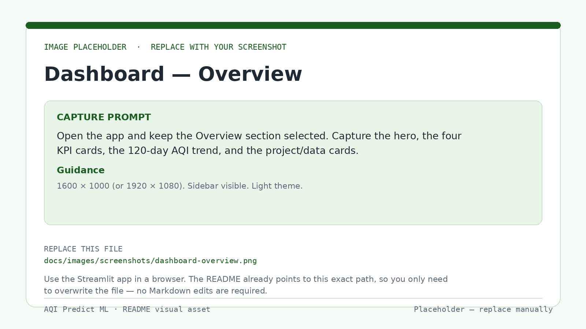 |
| **Historical air quality** — AQI trend, monthly trends, category distribution, pollutant analysis. | 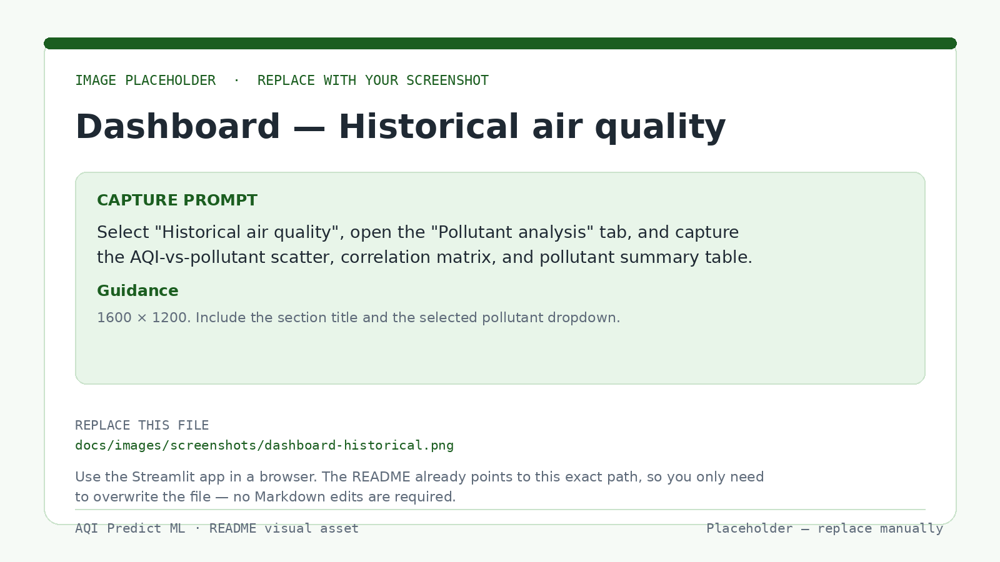 |
| **AQI prediction** — validated what-if inputs, model-generated next-day forecast, gauge, origin/target dates. | 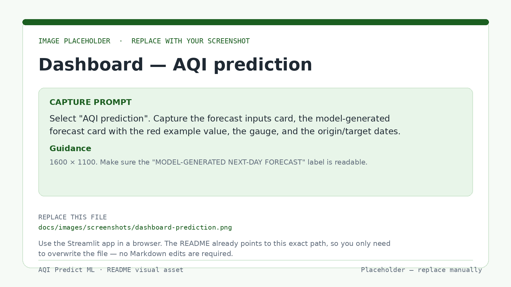 |
| **Model performance** — MAE/RMSE/R², actual vs predicted, residuals, comparison, feature importance. | 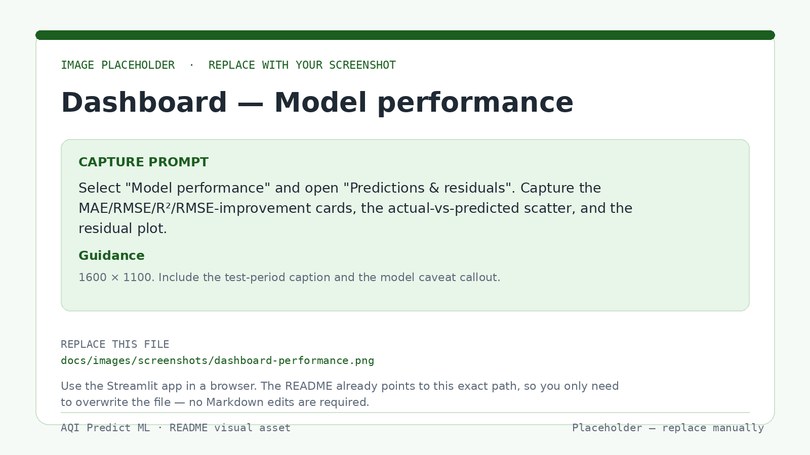 |
| **Environmental insights** — EDA findings, high-pollution episodes, health and environmental context. | 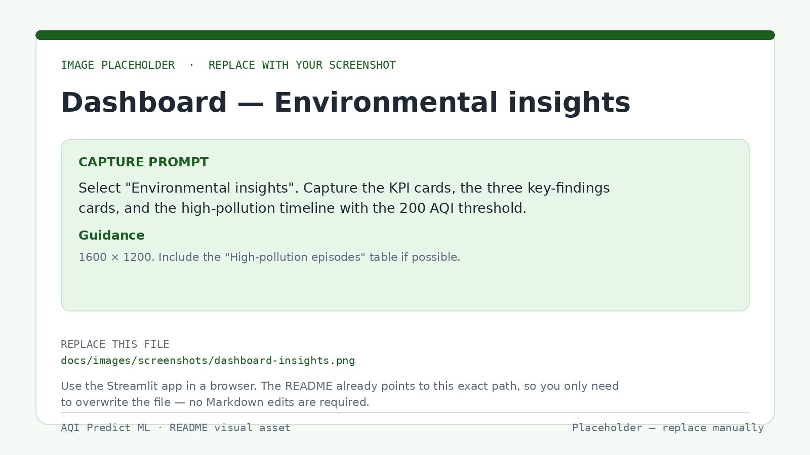 |
| **Project information** — provenance, feature contract, leakage controls, reproduction, limitations. | 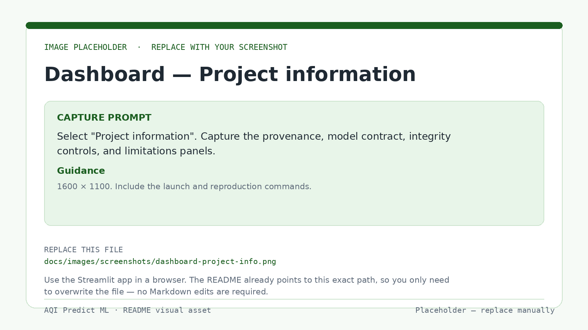 |
| **Mobile / responsive view** — 390 px viewport demonstration. | 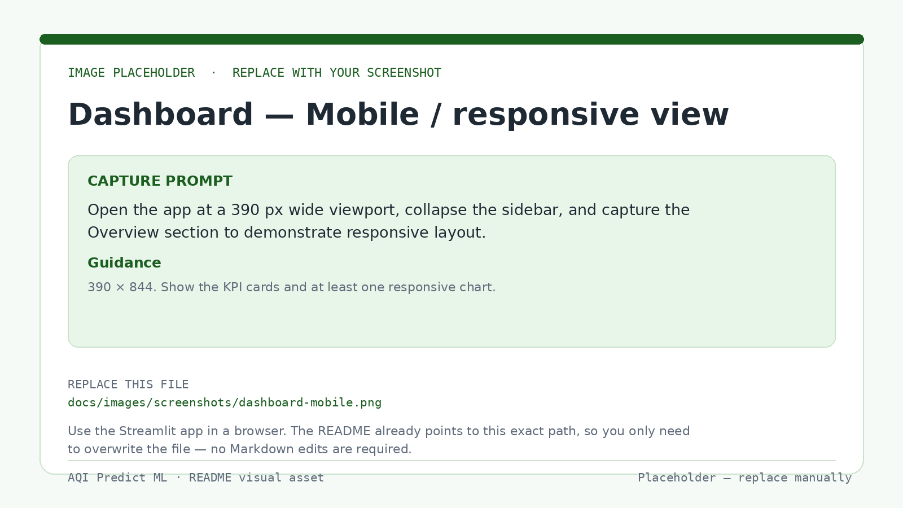 |

> **To replace a placeholder:** overwrite the file with a PNG of the same name.
> Useful prompts are embedded in each placeholder image and repeated in the
> screenshot guide.

### Actual evaluation figures

These images are **real saved outputs** from the final test evaluation. They are
copied into `docs/images/results/` so they render reliably on GitHub.

#### Actual vs predicted AQI

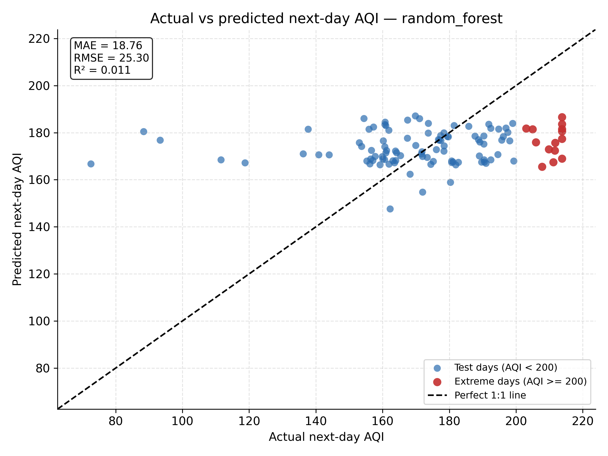

The model's predictions cluster in a narrow band (roughly 148–187) while actual
AQI spans 72.6–213.8. Red points mark actual extreme days (AQI ≥ 200). The
compression toward the mean is visible immediately.

#### Test-period time series

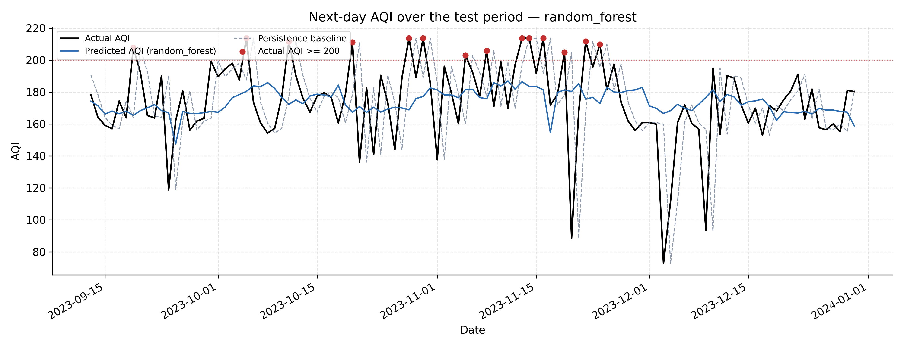

The Random Forest line is smoother than the observations. It follows the broad
level of the series but misses sharp clean-air dips and pollution spikes.

#### Prediction distribution and error by AQI range

| Prediction distribution | Error by AQI range |
| :---: | :---: |
| 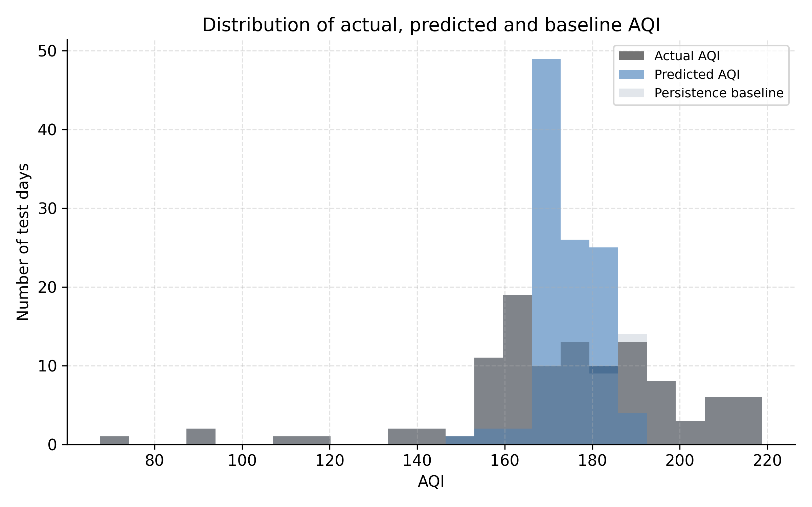 | 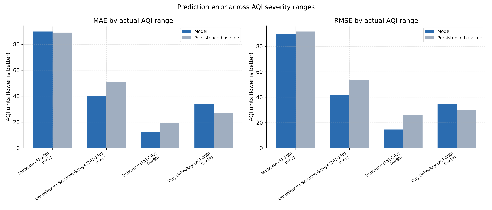 |
| The predicted distribution is much narrower than the actual distribution. | Most test days are in the 151–200 band; extreme days carry larger errors. |

#### Feature importance and residual distribution

| Feature importance | Residual distribution |
| :---: | :---: |
| 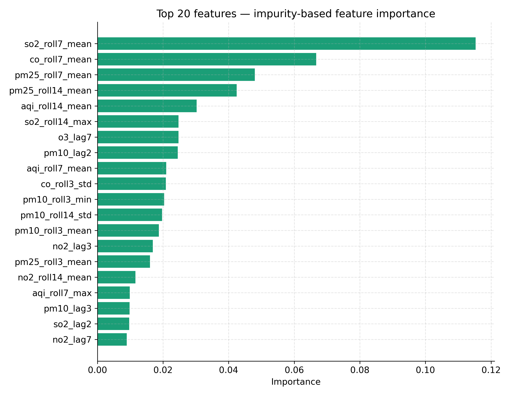 | 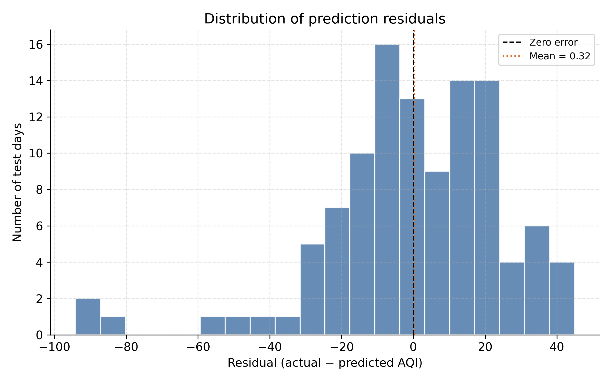 |
| Rolling SO₂, CO and PM2.5 statistics dominate impurity-based importance. | Residuals are centred near zero but have a wide spread and large outliers. |

#### Extreme-event errors

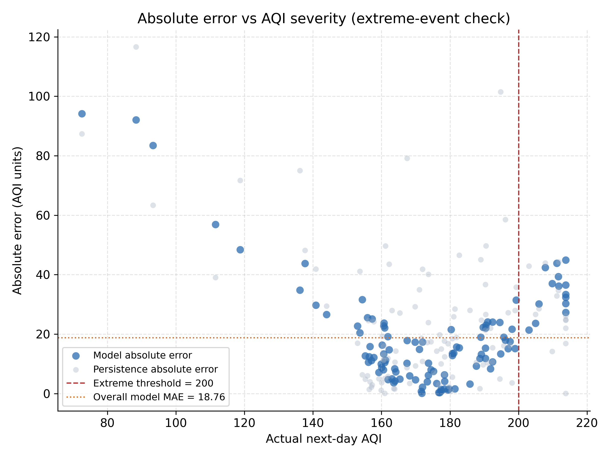

Absolute error rises sharply for the highest-AQI days. The model never predicts
an AQI ≥ 200, even though 14 test days crossed that threshold.

---

## Problem statement and objectives

**Problem.** Given daily pollutant measurements up to day *t*, estimate the AQI
for day *t + 1* for Kolkata.

**Objectives.**

1. Build a reproducible data → features → model → evaluation pipeline.
2. Use only information available at the forecast origin (no future leakage).
3. Compare several model families against a persistence baseline.
4. Select the model on a validation split, then evaluate once on a frozen test
   split.
5. Expose the saved model and honest performance diagnostics in an interactive
   dashboard.
6. Document limitations clearly enough that the model is not mistaken for an
   operational health-warning system.

---

## Dataset

### Coverage

| Property | Value |
| :--- | :--- |
| File used by the shipped model and dashboard | `data/processed/clean.csv` |
| Rows | **729** daily observations |
| Date range | **2022-01-01 → 2023-12-31** |
| Missing values | **0** |
| Duplicate dates | **0** |
| Pollutant columns | `pm25`, `pm10`, `no2`, `so2`, `o3`, `co` |
| Target construction | AQI derived from PM2.5, then shifted one day forward |

### Variables and units

| Column | Meaning | Unit |
| :--- | :--- | :--- |
| `pm25` | Fine particulate matter, ≤ 2.5 µm | µg/m³ |
| `pm10` | Coarse particulate matter, ≤ 10 µm | µg/m³ |
| `no2` | Nitrogen dioxide | µg/m³ |
| `so2` | Sulphur dioxide | µg/m³ |
| `o3` | Ground-level ozone | µg/m³ |
| `co` | Carbon monoxide | mg/m³ |
| `aqi` | AQI derived from PM2.5 | index (0–500) |
| `aqi_next_day` | AQI on the following calendar day (target) | index (0–500) |

### How AQI is calculated

This project does **not** use the CPCB composite AQI. It derives AQI from
**PM2.5 only**, using the US-EPA 2012 24-hour PM2.5 breakpoints:

| PM2.5 (µg/m³) | AQI category | AQI range |
| :---: | :--- | :---: |
| 0.0–12.0 | Good | 0–50 |
| 12.1–35.4 | Moderate | 51–100 |
| 35.5–55.4 | Unhealthy for Sensitive Groups | 101–150 |
| 55.5–150.4 | Unhealthy | 151–200 |
| 150.5–250.4 | Very Unhealthy | 201–300 |
| 250.5–350.4 | Hazardous | 301–400 |
| 350.5–500.4 | Hazardous | 401–500 |

The implementation uses continuous linear interpolation between breakpoints
(`src/feature_engineering/features.py::_pm25_to_aqi`), rather than a rounded
lookup table. This keeps the target continuous and reproducible.

> **Important:** because AQI is derived from PM2.5, the very high PM2.5–AQI
> correlation is **by construction**, not an independent environmental finding.

### Dataset at a glance

| Statistic | Value |
| :--- | :---: |
| Mean AQI | 169.1 |
| Median AQI | 170.3 |
| Standard deviation | 19.9 |
| Minimum AQI | 72.6 |
| Maximum AQI | 213.8 |
| Days with AQI ≥ 151 | 669 (91.8%) |
| Days with AQI ≥ 200 | 30 (4.1%) |
| Worst month (mean AQI) | November — 185.0 |
| Cleanest month (mean AQI) | August — 161.7 |

**AQI category distribution (US-EPA labels):**

| Category | Days | Share |
| :--- | ---: | ---: |
| Good (0–50) | 0 | 0.0% |
| Moderate (51–100) | 12 | 1.6% |
| Unhealthy for Sensitive Groups (101–150) | 43 | 5.9% |
| Unhealthy (151–200) | 644 | 88.3% |
| Very Unhealthy (201–300) | 30 | 4.1% |
| Hazardous (301–500) | 0 | 0.0% |

### Pollutant summary

| Pollutant | Mean | Median | Maximum | Correlation with AQI |
| :--- | ---: | ---: | ---: | ---: |
| PM2.5 | 94.33 µg/m³ | 94.00 µg/m³ | 164.20 µg/m³ | **0.941** |
| PM10 | 139.29 µg/m³ | 139.28 µg/m³ | 225.50 µg/m³ | −0.046 |
| NO₂ | 45.55 µg/m³ | 44.86 µg/m³ | 78.03 µg/m³ | 0.077 |
| SO₂ | 18.05 µg/m³ | 18.36 µg/m³ | 33.84 µg/m³ | 0.020 |
| O₃ | 34.93 µg/m³ | 34.68 µg/m³ | 58.81 µg/m³ | −0.074 |
| CO | 0.70 mg/m³ | 0.69 mg/m³ | 1.34 mg/m³ | 0.052 |

### Data provenance and scope — read this

- The shipped modelling series is a **processed two-year prototyping dataset**,
  not a live CPCB or OpenAQ feed. It is suitable for demonstrating the pipeline
  and dashboard, not for operational decisions.
- The repository also contains a **5-row 2015 CPCB-style sample**
  (`data/raw/kolkata_city_day.csv`) and related legacy smoke-test outputs. The
  shipped model and dashboard use the 2022–2023 `data/processed/clean.csv`, not
  that 5-row fixture.
- Some documents under `docs/` describe the earlier fixture or a future
  CPCB-scale dataset. For the shipped results, the authoritative sources are
  `models/best_model.json`, `results/metrics/*`, and
  [`documentation/model_evaluation.md`](documentation/model_evaluation.md).
- OpenAQ API v2 has been decommissioned. The project is therefore built around
  local processed CSVs rather than a live API dependency.

### Chronological splits

The feature table contains **721 rows** after lag/rolling features and the
next-day target are constructed. It is split chronologically, with no shuffling.
One boundary row is purged on each side of the validation block so that no target
overlaps the next split.

| Split | Rows | Dates | Purpose |
| :--- | ---: | :--- | :--- |
| Train | **503** | 2022-01-08 → 2023-05-26 | Fit candidate models |
| Validation | **107** | 2023-05-28 → 2023-09-11 | Select the model and hyperparameters |
| Test | **109** | 2023-09-13 → 2023-12-30 | Final, independent evaluation |

The test split is written by `prepare_data.py` but **never read by the training
script**. This is enforced by the pipeline structure and documented in
`models/best_model.json` (`test_split_used_during_training: false`).

---

## Methodology

### End-to-end flow

```mermaid
flowchart LR
    A[Raw / processed pollutant series] --> B[Cleaning and AQI derivation]
    B --> C[Lag and rolling feature engineering]
    C --> D[Chronological train / validation / test splits]
    D --> E[Train candidate models]
    E --> F[Validation-only model selection]
    F --> G[Freeze model and feature contract]
    G --> H[Independent test evaluation]
    H --> I[Saved model, metrics, figures]
    I --> J[Streamlit dashboard]
```

### 1. Preprocessing

`src/preprocessing/clean.py`:

- Parses dates, sorts chronologically, and drops duplicate dates.
- Keeps the six pollutant columns and coerces them to numeric.
- Drops rows with less than 60% non-missing pollutant values.
- Forward-fills short gaps (limit = 2 days) to preserve causality.
- Optionally clips IQR outliers (configurable; enabled in `config.yaml`).
- Drops any remaining incomplete rows.

The shipped `clean.csv` is already complete (729 rows, no missing values), so the
dashboard and training path can focus on feature construction.

### 2. Feature engineering

`src/feature_engineering/features.py` builds the **same features** for training
and dashboard inference through shared helpers:

| Feature group | Columns | Count |
| :--- | :--- | ---: |
| Base measurements | 6 pollutants + derived `aqi` | 7 |
| Lags | lag 1, 2, 3 and 7 days for every base column | 28 |
| Rolling statistics | windows 3, 7 and 14 days × mean/std/min/max for every base column | 84 |
| **Total** | | **119** |

The target is:

```text
aqi_next_day[t] = aqi[t + 1]
```

Rows with NaN lags or a missing next-day target are dropped, producing 721 usable
feature rows from the 729-row clean series.

#### Why the feature contract matters

The saved model records the exact column order in
`models/best_model.json`. Both training and inference select features with:

```python
X = features.loc[:, feature_columns]
```

This prevents silent column-order drift between scikit-learn training and the
dashboard.

### 3. Leakage prevention

Leakage is a central design concern:

- Lags and rolling features use **current and past values only**.
- The target is shifted **forward** (`shift(-1)`), never backward.
- The dashboard truncates history at the selected **forecast origin** before
  building lag/rolling features.
- The next-day actual value, when available for a historical origin, is used
  **only as an evaluation reference after the prediction is made**; it is never a
  model input.
- `prepare_data.py` purges boundary rows so a target cannot belong to the next
  split.

### 4. Candidate models

`src/model_training/train.py` trains four candidates in the shipped run:

| Model | Implementation | Key settings | Validation RMSE |
| :--- | :--- | :--- | ---: |
| **Persistence baseline** | Tomorrow = today's observed AQI | — | 27.05 |
| **Ridge regression** | `SimpleImputer` → `StandardScaler` → `Ridge(alpha=1.0)` | Linear baseline | 25.16 |
| **Random Forest** | `RandomForestRegressor` | `n_estimators=200`, `max_depth=10`, `random_state=42`, `n_jobs=-1` | **21.51 (selected)** |
| **HistGradientBoosting** | `HistGradientBoostingRegressor` | `max_iter=300`, `learning_rate=0.05`, `max_depth=8` | 22.76 |
| **SVR** | `SimpleImputer` → `StandardScaler` → `SVR` | `C=100`, `gamma="scale"`, `epsilon=0.1` | 23.87 |
| *XGBoost (optional)* | Only if the package is installed | Not part of the shipped comparison | — |

### 5. Model-selection rule

The selection rule is deliberately conservative:

> Choose the candidate with the **lowest validation RMSE** among models that
> improve the persistence baseline by **more than 5%**. If none clears that
> threshold, fall back to the lowest validation RMSE.

All four shipped candidates cleared the threshold. **Random Forest** had the
lowest validation RMSE and was frozen before the test evaluation.

---

## Model selection and results

### Validation performance (model selection only)

| Model | Validation MAE | Validation RMSE | Validation R² | RMSE improvement vs persistence |
| :--- | ---: | ---: | ---: | ---: |
| Linear regression (Ridge) | 19.28 | 25.16 | −0.457 | 6.97% |
| **Random Forest** | **14.90** | **21.51** | **−0.065** | **20.47%** |
| Gradient Boosting | 16.20 | 22.76 | −0.192 | 15.86% |
| SVR | 17.57 | 23.87 | −0.311 | 11.76% |
| Persistence baseline | 19.71 | 27.05 | −0.684 | — |

### Independent test performance

| Model | MAE | RMSE | R² | Mean residual (actual − predicted) | Max absolute error | RMSE improvement vs persistence |
| :--- | ---: | ---: | ---: | ---: | ---: | ---: |
| **Random Forest (selected)** | **18.76** | **25.30** | **0.011** | **0.32** | **94.11** | **21.08%** |
| Persistence baseline | 23.76 | 32.06 | −0.588 | −0.10 | 116.59 | — |

**How to read these metrics**

- **MAE** — average absolute error in AQI points. Typical error is about **18.8
  points**.
- **RMSE** — penalises large misses more heavily. It is higher than MAE, which
  signals occasional large errors.
- **R²** — fraction of test variance explained. **0.011** means the model is
  barely better than predicting the test mean.
- **Mean residual** — positive means the model **under-predicts** on average.
  The selected model's mean residual is **0.32 AQI points**, but that small
  average hides large opposing errors on clean and extreme days.

### Prediction range compression

| Quantity | Actual AQI | Model prediction |
| :--- | ---: | ---: |
| Minimum | 72.60 | 147.58 |
| Maximum | 213.80 | 187.09 |
| Range | 141.21 | 39.51 |
| Mean | 174.26 | 173.94 |
| Standard deviation | 25.56 | 7.09 |

The predicted range is **0.28×** the actual range, and the correlation between
actual and predicted AQI is only **0.159**. This is classic regression-to-the-mean
behaviour: the model avoids extreme predictions, over-predicts clean days, and
under-predicts pollution peaks.

### Extreme-event performance

Working definition: **actual next-day AQI ≥ 200** (Very Unhealthy).

| Subset | n | Model MAE | Baseline MAE | Model R² | Mean residual | Extreme recall |
| :--- | ---: | ---: | ---: | ---: | ---: | ---: |
| All test days | 109 | 18.76 | 23.76 | 0.011 | 0.32 | — |
| AQI ≥ 200 | 14 | 34.15 | 27.28 | −92.41 | 34.15 | **0 / 14** |
| Top 10% (AQI ≥ 206.4) | 11 | 36.64 | 25.82 | −363.31 | 36.64 | — |

Key facts:

- **0 of 14** extreme days were predicted as extreme.
- The highest prediction is **187.09**, while the highest actual value is
  **213.80** — a peak under-prediction of **26.71 AQI points**.
- On extreme days the model is **worse than persistence** (MAE 34.15 vs 27.28).
- Extreme-day errors are nearly **1.82×** the overall MAE.

### Feature importance

Impurity-based importance for the selected Random Forest:

| Rank | Feature | Importance |
| ---: | :--- | ---: |
| 1 | `so2_roll7_mean` | 0.1153 |
| 2 | `co_roll7_mean` | 0.0667 |
| 3 | `pm25_roll7_mean` | 0.0480 |
| 4 | `pm25_roll14_mean` | 0.0425 |
| 5 | `aqi_roll14_mean` | 0.0303 |
| 6 | `so2_roll14_max` | 0.0247 |
| 7 | `o3_lag7` | 0.0247 |
| 8 | `pm10_lag2` | 0.0245 |
| 9 | `aqi_roll7_mean` | 0.0210 |
| 10 | `co_roll3_std` | 0.0209 |

Importance is **not causation**. Many features are lagged or rolling versions of
the same pollutants and are highly correlated, so the ranking reflects model
behaviour rather than a physical explanation.

### Honest interpretation

The model **does** reduce average error versus persistence, but it is **not** a
reliable AQI forecaster:

- Near-zero R²: it explains almost none of the day-to-day variance.
- Severe range compression: it is biased toward the middle of the training
  distribution.
- Zero extreme-day recall: it cannot be used for pollution alerts.
- The test set is a single 109-day window, so uncertainty around these numbers is
  substantial.

This is exactly why the dashboard reports the metrics, residuals, baseline, and
caveats together rather than showing only a headline MAE.

---

## Interactive Streamlit dashboard

The dashboard is a six-section application that loads the **saved model** and
evaluation artifacts. It never retrains on start-up.

### Sections

| Section | What it contains |
| :--- | :--- |
| **Overview** | Project introduction, latest observed AQI and category, dataset coverage, selected model, recent AQI trend, project/data context |
| **Historical air quality** | AQI trend with severity references, monthly pollution trends, AQI category distribution, pollutant scatter, correlation matrix, pollutant summary |
| **AQI prediction** | Forecast origin selector, validated what-if pollutant inputs, model-generated next-day forecast, AQI gauge, origin/target dates, recent history vs forecast |
| **Model performance** | Test MAE/RMSE/R², RMSE improvement, actual vs predicted, residuals, model comparison, feature importance, error analysis |
| **Environmental insights** | EDA findings computed from the loaded data, high-pollution timeline, episodes at AQI ≥ 200, health/environment context, AQI category reference |
| **Project information** | Provenance, feature contract, leakage controls, reproducibility commands, limitations |

### How the prediction works

1. Load `data/processed/clean.csv` and the saved model bundle.
2. Select a **forecast origin** (a historical observation date).
3. Truncate history at the origin — **no future rows are used**.
4. Optionally edit the six pollutant values for a what-if scenario.
5. Recompute AQI from PM2.5 using the training formula.
6. Build lag/rolling features with the **same helper used during training**.
7. Select the exact saved feature columns from `models/best_model.json`.
8. Validate the matrix shape and check for NaN values.
9. Predict, classify the AQI, and display the forecast with **origin and target
   dates**.
10. If the origin is historical, show the observed next-day AQI **after the
    prediction** as an evaluation reference — never as an input.

### Dashboard design

- **Palette:** green, white, and dark neutral.
- **Typography:** only **Inter** (interface/body) and **JetBrains Mono**
  (numbers/metadata), including Plotly charts, HTML tables, and dropdown portals.
- **Charts:** responsive Plotly figures with clear units and legends.
- **Tables:** theme-native HTML tables so canvas dataframes cannot bypass the
  font system.
- **Navigation:** sidebar radio with six sections.
- **Error handling:** missing artifacts, invalid inputs, non-finite predictions,
  and feature-contract mismatches surface as clear messages.
- **No live feed:** every observation comes from the historical snapshot;
  forecasts are explicitly labelled as model-generated.

### Launch command

From the project root:

```bash
source .venv/bin/activate
streamlit run streamlit_app/app.py
```

Or use the wrapper:

```bash
./scripts/run_streamlit.sh
```

Then open the URL printed by Streamlit, usually
`http://localhost:8501`.

If port 8501 is busy:

```bash
streamlit run streamlit_app/app.py --server.port 8502
```

---

## Repository structure

```text
aqi-predict-ml/
├── streamlit_app/
│   ├── app.py                        # single dashboard entry point
│   ├── components/
│   │   ├── theme.py                  # palette, AQI bands, CSS, HTML helpers
│   │   ├── charts.py                 # Plotly chart builders
│   │   ├── data_service.py           # cached loaders, feature contract, prediction
│   │   ├── overview.py               # Section 01
│   │   ├── historical.py             # Section 02
│   │   ├── prediction.py             # Section 03
│   │   ├── performance.py            # Section 04
│   │   ├── insights.py               # Section 05
│   │   └── project_info.py           # Section 06
│   └── __init__.py
├── config.yaml                       # Central project configuration
├── data/
│   ├── raw/                          # Raw / legacy fixture CSVs
│   └── processed/
│       ├── clean.csv                 # 729-row modelling series
│       ├── features.csv              # 721-row engineered feature table
│       └── splits/                   # train/validation/test + split_info.json
├── docs/
│   ├── images/
│   │   ├── results/                  # README copies of evaluation figures
│   │   └── screenshots/              # dashboard screenshot placeholders
│   ├── DESIGN.md
│   ├── DATA_SOURCES.md
│   ├── MODEL_CARD.md
│   ├── API.md
│   ├── data_dictionary.md
│   ├── feature_dictionary.md
│   ├── eda_findings.md
│   └── dataset_audit.md
├── documentation/
│   └── model_evaluation.md           # full generated evaluation report
├── experiments/aqi_forecasting/
│   ├── comparison_table.csv
│   ├── experiment_info.json
│   ├── final_selection.json
│   └── experiment.log
├── models/
│   ├── best_model.json               # selection record + feature contract
│   ├── random_forest/model.pkl
│   ├── gradient_boosting/model.pkl
│   ├── linear_regression/model.pkl
│   └── svr/model.pkl
├── results/
│   ├── metrics/                      # final metrics, predictions, errors, importance
│   └── visualizations/evaluation/    # generated evaluation PNGs
├── scripts/
│   ├── install.sh
│   ├── run_forecasting.sh
│   ├── run_model_training.sh
│   ├── run_final_evaluation.sh
│   ├── run_pipeline.sh               # general/legacy entry point
│   └── run_streamlit.sh
├── src/
│   ├── utils/                        # config + I/O helpers
│   ├── preprocessing/                # cleaning and data-quality checks
│   ├── exploratory/                  # EDA
│   ├── feature_engineering/          # shared training/inference features
│   ├── model_training/               # splits, training, selection
│   ├── model_evaluation/             # final evaluation + report generation
│   └── scripts/                      # CLI entry points
├── tests/                            # pytest suite
├── README.md                         # this file
├── README_forecasting.md             # pipeline companion notes
├── pyproject.toml
├── requirements.txt
└── LICENSE
```

> `data/processed/*`, `models/**/*.pkl`, and `visualizations/*.png` are
> git-ignored. In this working copy they are present; on a fresh clone, regenerate
> them with the commands below. `models/best_model.json` is tracked.

---

## Installation

### Requirements

- Python **3.10+** (tested on Python 3.12.3)
- Linux, macOS, or Windows
- No GPU required

### Setup

```bash
git clone <repository-url> aqi-predict-ml
cd aqi-predict-ml

python3 -m venv .venv
source .venv/bin/activate          # Linux / macOS
# .venv\Scripts\activate           # Windows PowerShell

python -m pip install --upgrade pip
pip install -r requirements.txt
```

Or use the wrapper, which also installs the editable package with dev extras:

```bash
./scripts/install.sh
```

### Dependency note

`requirements.txt` pins:

```text
numpy==1.26.4
pandas==2.2.2
scikit-learn==1.5.1
pyarrow==16.1.0
streamlit==1.41.0
```

`pyarrow==16.1.0` is intentional: newer Arrow wheels require NumPy 2.x, while this
project pins NumPy 1.26.4. Upgrading one without the other can produce:

```text
pyarrow requires NumPy 2.0 or newer, found 1.26.4
```

---

## Quick start

### Run the dashboard only

Use this if `data/processed/clean.csv`, `models/best_model.json`, and a saved
model file already exist:

```bash
source .venv/bin/activate
streamlit run streamlit_app/app.py
```

### Run the tests

```bash
source .venv/bin/activate
python -m pytest -p no:warnings
```

Expected result:

```text
77 passed
```

### Rebuild everything from the shipped processed series

```bash
source .venv/bin/activate

./scripts/run_forecasting.sh       # features + chronological splits
./scripts/run_model_training.sh    # train candidates + validation-only selection
./scripts/run_final_evaluation.sh  # frozen test evaluation + figures/report
```

### Individual stages

```bash
python -m src.feature_engineering.features   # → data/processed/features.csv
python -m src.model_training.prepare_data    # → data/processed/splits/*
python -m src.model_training.train           # → models/* + models/best_model.json
python -m src.model_evaluation.evaluate_final  # → results/ + documentation/model_evaluation.md
```

> The older `src.scripts.run_pipeline` / `scripts/run_pipeline.sh` path is a
> general-purpose/legacy entry point. For the shipped 2022–2023 artifacts, use
> the three forecasting scripts above.

---

## Reproducing the shipped results

The exact reproduction order is:

```bash
source .venv/bin/activate

# 1. Build the 721-row feature table and chronological splits.
./scripts/run_forecasting.sh

# 2. Train all candidates and select on validation RMSE only.
./scripts/run_model_training.sh

# 3. Load the frozen model and evaluate once on the untouched test split.
./scripts/run_final_evaluation.sh
```

The scripts write:

- `data/processed/features.csv`
- `data/processed/splits/{train,validation,test}.csv`
- `data/processed/splits/split_info.json`
- `models/<model>/model.pkl`
- `models/best_model.json`
- `experiments/aqi_forecasting/*`
- `results/metrics/*`
- `results/visualizations/evaluation/*.png`
- `documentation/model_evaluation.md`

Integrity properties of the shipped evaluation:

- The test split was created chronologically and was **not used for training or
  selection**.
- The model and feature list were frozen before test evaluation.
- `models/best_model.json` records `test_split_used_during_training: false`.
- The final evaluation script never fits or tunes a model.

Artifact hashes and the exact test range are recorded in
`results/metrics/evaluation_metadata.json`.

---

## Configuration

`config.yaml` centralises paths, splits, and model settings:

```yaml
project:
  city: "Kolkata"
  forecast_horizon: "next_day"

features:
  lags: [1, 2, 3, 7]
  rolling_windows: [3, 7, 14]
  target: "aqi_next_day"

training:
  test_size: 0.20
  validation_size: 0.10
  random_state: 42
  n_jobs: -1
  models:
    - "random_forest"
    - "gradient_boosting"
    - "xgboost"
    - "linear_regression"
    - "svr"

evaluation:
  metrics: ["mae", "rmse", "r2"]
  primary_metric: "rmse"
```

Notes:

- `xgboost` is optional and is only trained if the package is installed. It is not
  in the pinned requirements and is not part of the shipped comparison.
- The actual split ratios used by `prepare_data.py` are **70% train / 15%
  validation / 15% test**, with boundary-row purging. The `test_size` and
  `validation_size` values in `config.yaml` are retained for compatibility with
  the general pipeline path.
- `random_state=42` and `n_jobs=-1` are recorded for reproducibility.

---

## Testing

The suite covers data contracts, cleaning, feature engineering, leakage safety,
prediction consistency, chart construction, font configuration, and dashboard
navigation.

```bash
python -m pytest -p no:warnings
```

**Latest result: 77 passed.**

| Test file | Focus |
| :--- | :--- |
| `tests/test_clean.py` | Raw-data cleaning and missing-value handling |
| `tests/test_config.py` | Config loading and path resolution |
| `tests/test_preprocessing.py` | Preprocessing contracts |
| `tests/test_features.py` | AQI derivation and feature construction |
| `tests/test_feature_engineering.py` | Lag/rolling feature correctness |
| `tests/test_evaluation.py` | Metric and evaluation artifact contracts |
| `tests/test_eda.py` | EDA summary behavior |
| `tests/test_dashboard.py` | Data service, leakage, prediction, charts, fonts, AppTest navigation/controls |

The dashboard tests use Streamlit's `AppTest` and the real saved artifacts. They
are skipped automatically if `models/best_model.json` is missing.

---

## Outputs and artifacts

| Artifact | Meaning |
| :--- | :--- |
| `models/best_model.json` | Validation-only selection record and exact 119-column feature contract |
| `models/<model>/model.pkl` | Joblib-serialized fitted model |
| `results/metrics/final_metrics.csv` | Selected-model and persistence test metrics |
| `results/metrics/test_predictions.csv` | Per-origin predictions, actuals, residuals, baseline |
| `results/metrics/metrics_by_aqi_range.csv` | Error by US-EPA AQI category |
| `results/metrics/extreme_event_metrics.csv` | All-days, AQI ≥ 200, and top-10% subsets |
| `results/metrics/extreme_events.csv` | Consecutive extreme-event runs |
| `results/metrics/largest_errors.csv` | Largest individual test errors |
| `results/metrics/feature_importance.csv` | Full feature-importance table |
| `results/metrics/evaluation_metadata.json` | Hashes, feature list, test range, diagnostics |
| `results/visualizations/evaluation/*.png` | Generated evaluation figures |
| `documentation/model_evaluation.md` | Full human-readable evaluation and limitations report |
| `docs/images/results/*` | README copies of selected evaluation figures |
| `docs/images/screenshots/*` | Dashboard screenshot placeholders |

---

## Troubleshooting

### `FileNotFoundError: models/best_model.json`

The model artifacts are not present. Rebuild them:

```bash
./scripts/run_forecasting.sh
./scripts/run_model_training.sh
./scripts/run_final_evaluation.sh
```

### `pyarrow requires NumPy 2.0 or newer`

Keep the pinned versions together:

```bash
pip install numpy==1.26.4 pyarrow==16.1.0
```

### Dashboard opens but a section reports missing data

Run Streamlit from the project root so relative artifact paths resolve:

```bash
cd /path/to/aqi-predict-ml
streamlit run streamlit_app/app.py
```

### Port 8501 is already in use

Use another port:

```bash
streamlit run streamlit_app/app.py --server.port 8502
```

### `missing ScriptRunContext` or `No runtime found` warnings

These warnings appear when Streamlit or its caches are used outside a running app
(for example, in plain `pytest`). They are harmless.

### Why is R² so low?

The processed daily series has weak day-to-day predictability, and the feature
set omits meteorology (wind, boundary-layer height, temperature, humidity,
rainfall) and emission-source changes. The evaluation report documents this
explicitly; the low R² is a property of the data and model, not a bug in the
scoring code.

### Why are predictions compressed?

Tree ensembles minimize squared error by shrinking predictions toward the
training distribution. On this test window, the predicted range is only 0.28× the
actual range. Treat the model as an educational estimate, not an alert system.

### The README images look like placeholders

That is intentional. Replace the PNGs in `docs/images/screenshots/` with your own
screenshots using the prompts in
[`docs/images/screenshots/README.md`](docs/images/screenshots/README.md).

---

## Limitations and responsible use

This project is for **education, research, and portfolio demonstration**. It is
**not** an official AQI bulletin and must not be used as the sole basis for health
or policy decisions.

Key limitations:

1. **Prototype dataset.** The shipped series is a processed two-year
   demonstration dataset, not a live official CPCB/OpenAQ feed.
2. **PM2.5-only AQI.** AQI is derived from PM2.5 using US-EPA breakpoints, not the
   CPCB composite index.
3. **Near-zero R².** The model explains almost none of the day-to-day variance.
4. **Zero extreme-day recall.** It missed all 14 test days with AQI ≥ 200.
5. **Range compression.** It over-predicts clean days and under-predicts peaks.
6. **No meteorology.** Wind, temperature, humidity, rainfall, and boundary-layer
   height are absent.
7. **Single test window.** 109 days is a small sample; metrics have wide
   uncertainty.
8. **No health validation.** AQI is an environmental index, not a health outcome.
9. **City-specific.** Do not transfer the model to another city or period without
   retraining and re-evaluation.
10. **Not for operational alerts.** Use official monitoring and forecasting
    systems for public-health decisions.

---

## Future work

- Replace the prototype series with a verified CPCB/OpenAQ v3 dataset covering a
  longer period.
- Add meteorological features (wind speed/direction, temperature, humidity,
  rainfall, boundary-layer height).
- Add rolling-origin cross-validation and a second chronological test window.
- Evaluate quantile forecasts or prediction intervals instead of point forecasts
  only.
- Model extreme events explicitly (classification/rare-event weighting) and report
  recall/precision alongside MAE.
- Improve the dashboard with calibrated uncertainty bands and downloadable
  reports.
- Containerise the app and add CI for tests and artifact contracts.

---

## Documentation index

| Document | Purpose |
| :--- | :--- |
| [`documentation/model_evaluation.md`](documentation/model_evaluation.md) | Full generated test evaluation, error analysis, extreme events, limitations |
| [`docs/MODEL_CARD.md`](docs/MODEL_CARD.md) | Model card: intended use, training, evaluation, ethics |
| [`docs/DESIGN.md`](docs/DESIGN.md) | Architecture principles and data flow |
| [`docs/API.md`](docs/API.md) | Public Python functions |
| [`docs/data_dictionary.md`](docs/data_dictionary.md) | Data columns and integrity rules |
| [`docs/feature_dictionary.md`](docs/feature_dictionary.md) | Feature reference |
| [`docs/DATA_SOURCES.md`](docs/DATA_SOURCES.md) | Data-source context and limitations |
| [`docs/eda_findings.md`](docs/eda_findings.md) | EDA notes (see provenance note above) |
| [`docs/dataset_audit.md`](docs/dataset_audit.md) | Legacy 5-row fixture audit |
| [`README_forecasting.md`](README_forecasting.md) | Pipeline companion notes |
| [`docs/images/screenshots/README.md`](docs/images/screenshots/README.md) | Screenshot capture prompts and replacement guide |

> Where documents disagree, use `models/best_model.json`, `results/metrics/*`, and
> `documentation/model_evaluation.md` for the shipped results. Some legacy docs
> still describe the original 5-row 2015 fixture or a future CPCB-scale dataset.

---

## License and acknowledgements

**License:** MIT — see [`LICENSE`](LICENSE).

**Acknowledgements:**

- The project was designed around publicly available CPCB-style Kolkata daily
  pollutant data and open environmental-data practices. The shipped processed
  series is a prototyping input; it is not an official monitoring feed.
- Built with [scikit-learn](https://scikit-learn.org/),
  [pandas](https://pandas.pydata.org/), [NumPy](https://numpy.org/),
  [Streamlit](https://streamlit.io/), and [Plotly](https://plotly.com/python/).
- Thanks to the open-source maintainers whose tools make reproducible
  environmental-data experiments possible.

---

### A note on the image placeholders

The dashboard previews in this README are **self-describing placeholders** that
include the capture prompt and target filename. They are safe to commit and
replace later:

```text
docs/images/screenshots/dashboard-overview.png
docs/images/screenshots/dashboard-historical.png
docs/images/screenshots/dashboard-prediction.png
docs/images/screenshots/dashboard-performance.png
docs/images/screenshots/dashboard-insights.png
docs/images/screenshots/dashboard-project-info.png
docs/images/screenshots/dashboard-mobile.png
```

The evaluation figures under `docs/images/results/` are **real saved outputs** and
do not need to be replaced.
